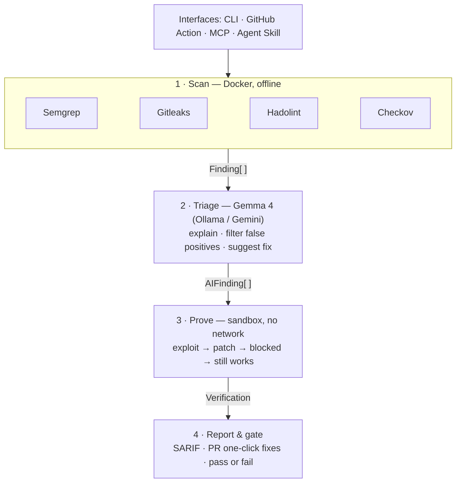

<div align="center">

# ExhibitA

### An AI security reviewer that proves the fix — not just the finding.

*Exploit it. Patch it. Verify it. On an open model, offline.*

[](LICENSE)
[](https://ai.google.dev/gemma)
[](#offline)
[](skills/exhibita/SKILL.md)

</div>

---

Scanners produce long lists of warnings, most of which developers learn to ignore.
ExhibitA does something different: it asks the open **Gemma 4** model to explain each
finding and filter the noise, and for the serious ones it **proves the bug is real** —
it runs the app in an isolated sandbox, confirms the vulnerability with a black-box
exploit, applies the AI's fix, and checks the exploit no longer works while the app
still behaves.

> **Every finding comes with evidence.**

It runs four ways from one core — a **CLI**, a **GitHub Action**, an **MCP server**,
and an **Agent Skill** — against either the cloud Gemini API or a fully offline
local model.

## How it works



Four scanners find the suspects; Gemma 4 explains and filters them; the sandbox
proves the critical ones; the report gates the build. The proof uses the same
black-box techniques a DAST scanner uses — a boolean
true/false difference, a `/etc/passwd` read, a timing delay, an evaluated
expression, an unescaped reflection — so it confirms the bug on real apps, not
just a crafted demo. The target runs through **its own Dockerfile** when it has
one, so the language and framework don't matter.

## What it finds

**Proven exploitable in the sandbox (6 classes):** SQL injection · command
injection · path traversal · server-side template injection · reflected XSS · XXE.

**Detected, explained, and fixed:** Flask debug mode, `eval`/`exec`, unsafe
`yaml.load`, SSRF, weak hashing; hardcoded **secrets** (Gitleaks); **Dockerfile**
issues (Hadolint); **Kubernetes / Terraform / GitHub Actions** misconfig (Checkov).

## Why it's different

| | Scanners (Semgrep, Snyk…) | AI pentesters (Strix, Shannon…) | **ExhibitA** |
|---|:---:|:---:|:---:|
| Finds issues | ✅ | ✅ | ✅ |
| Proves the bug is real | ❌ | ✅ | ✅ |
| **Proves the fix works & nothing breaks** | ❌ | — | ✅ |
| One-click fix in the PR | — | ❌ | ✅ |
| Blocks a merge only *with proof* | ❌ | ❌ | ✅ |
| Runs offline on an open model | ❌ | partial | ✅ |

## Tech stack

| Layer | What we use |
|---|---|
| Language | Python 3.12 |
| CLI / types / HTTP | Typer · Pydantic v2 (validated data at every step) · httpx · Rich |
| Scanners | Semgrep · Gitleaks · Hadolint · Checkov (run as official Docker images) |
| AI | **Gemma 4** — Ollama (`gemma4:e4b`, 4-bit, offline) or the Gemini API (`gemma-4-31b-it`), behind one interface |
| Sandbox | Docker — the target's own Dockerfile, or an auto-built `exhibita-sandbox` image |
| Agents | Model Context Protocol server + an Agent Skill |
| CI | GitHub composite Action · SARIF upload · inline PR suggestions |
| Config / tests | `.exhibita.yml` (PyYAML) · pytest |

No web framework, no database, no agent framework — a deterministic, typed pipeline.

## Install the CLI

```bash
pip install exhibita                     # once published to PyPI
# — or from source —
git clone https://github.com/dhruvdumra/exhibit-a.git
cd exhibit-a
pip install -e .
```

**Prerequisites:** Docker running, and **one** model source —
- *offline:* install [Ollama](https://ollama.com), then `ollama pull gemma4:e4b`, or
- *cloud:* set `GEMINI_API_KEY`.

Then:

```bash
exhibita doctor                          # checks Docker + model; starts Docker if installed
exhibita scan   demo/vulnerable_app      # scan + AI triage
exhibita verify demo/vulnerable_app      # scan + triage + sandbox proof (the headline)
```

No flags needed: the backend auto-selects (local model if present, else the API key),
and the sandbox image builds itself on first `verify`. Force a backend with
`--backend ollama|gemini`; switch explanation language with `--lang te`.

<a name="offline"></a>**Offline isn't the fallback — it's the fast path.** With
`gemma4:e4b` on a laptop GPU the whole review runs with the Wi-Fi off; nothing
leaves the machine.

## The interfaces

- **CLI** — `exhibita scan` / `exhibita verify` (above).
- **GitHub Action** — [`action.yml`](action.yml) + [`.github/workflows/review.yml`](.github/workflows/review.yml):
  on every PR it posts inline review comments with one-click fixes, uploads SARIF to
  the Security tab, and fails the check only on a proven critical. Open the PR from a
  branch (not a fork) and set `GEMINI_API_KEY` as a repo secret.
- **Agent Skill** — [`skills/exhibita/SKILL.md`](skills/exhibita/SKILL.md), compliant
  with the Agent Skill open standard, so a coding agent can check its own changes
  before opening a PR.
- **MCP server** — `python -m exhibita.mcp_server` exposes `scan`, `verify`, and
  `threat_model` over the Model Context Protocol, so any MCP-aware agent can call
  ExhibitA as a tool.

## Configuration

An optional [`.exhibita.yml`](.exhibita.example.yml) selects scanners, ignore paths,
the gate threshold, the language, and — for frameworks beyond Flask — declares the
HTTP routes to prove against.

## Benchmark

On **OWASP Juice Shop** (a real, intentionally-vulnerable app), Semgrep's registry
rules raise a wall of alerts; ExhibitA explains each, and **11 of 26** server-side
alerts fall into classes it can *prove* exploitable when the app is run. See
[`BENCHMARK.md`](BENCHMARK.md) (reproduce with `python scripts/benchmark.py`).

## Honest scope

ExhibitA genuinely proves bugs on **self-contained web apps it can run** (its own
Dockerfile, or a Python app in the sandbox image). What it does *not* yet do: run
multi-service apps that need a live database, locate routes automatically outside
Flask (declare them in `.exhibita.yml`), or write custom code rules for languages
other than Python (the secret and infrastructure scanners are language-agnostic).
Those are the roadmap, not claims.

## Development

```bash
pip install -e ".[dev]"
pytest                      # 80+ unit tests; 3 Docker integration tests when Docker is up
python scripts/capture_fixtures.py   # refresh scanner fixtures from the demo app
```

## Built with AI

Per MLH rules, AI tools used: **Claude Code** (pair-programming the implementation)
and **Gemma 4** (the review engine itself, via Ollama and the Gemini API).

## License

MIT. Built on open tools — Semgrep, Gitleaks, Hadolint, Checkov — and Google's open
**Gemma 4** model.
